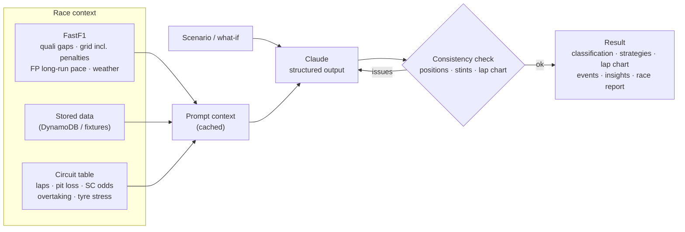
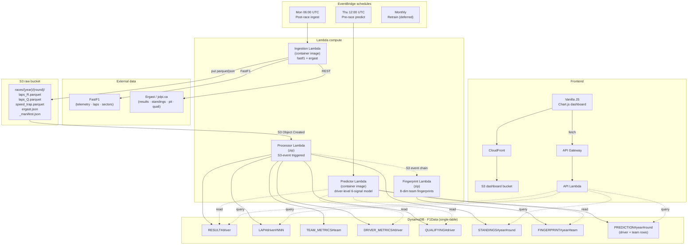
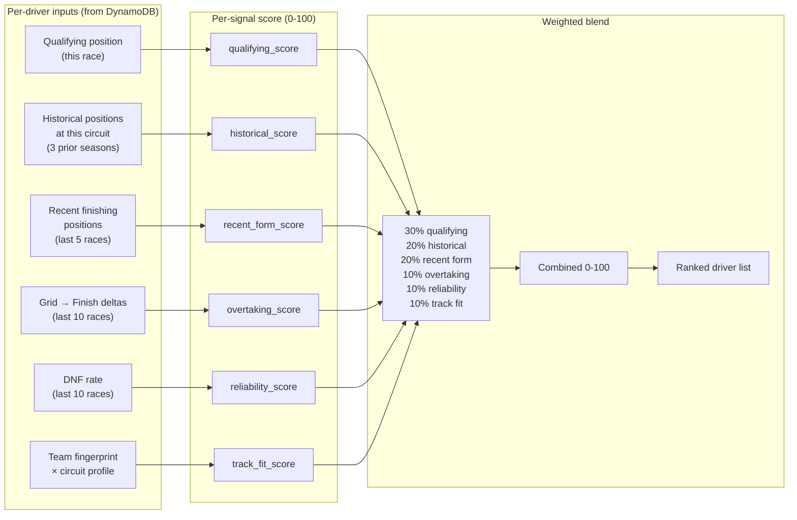

# PitStop — AI Race Simulator

Pick a Grand Prix, describe a scenario ("rain from lap 30", "pole sitter starts from the pit lane"), and **Claude simulates the race lap by lap**: race pace, tyre degradation, pit-wall strategy calls, safety cars, overtakes, retirements and the final classification. Then ask follow-up **what-ifs** ("what if NOR had pitted under the safety car?") and compare the versions side by side.

The dashboard is now simulator-first. The serverless data pipeline described further down (FastF1 + Ergast → S3 → DynamoDB) is still here and feeds the simulator's race context.

## Quick start

```bash
pip install -r simulator/requirements.txt
export ANTHROPIC_API_KEY=sk-ant-...        # without it the app runs in offline demo mode
python -m simulator.server                 # or: make sim
open http://localhost:8080
```

Command line:

```bash
python -m simulator races 2025                                   # calendar
python -m simulator context 2024 5                               # see exactly what Claude is given (no API call)
python -m simulator run 2024 5 --scenario "Safety car on lap 12"  # one simulated race
python -m simulator run 2024 5 --runs 5                          # 5 independent runs -> win/podium/points %
python -m simulator chat 2024 5                                  # interactive what-if loop
```

## How it works



| Piece | File |
|---|---|
| Race context builders (`fastf1`, `fixtures`/DynamoDB, `model` knowledge only; `auto` tries them in order) | `simulator/context.py` |
| Circuit facts + 2024–2026 calendars (offline fallback) | `simulator/circuits.py` |
| Output schema Claude must return | `simulator/schema.py` |
| Claude calls, what-if sessions, Monte Carlo runs | `simulator/engine.py` |
| Consistency checks, points, accuracy vs the real result | `simulator/validate.py` |
| Local API + static dashboard | `simulator/server.py`, `frontend/` |
| Offline demo pace model (no AI, for UI work and tests) | `simulator/demo.py` |

- **Model:** `claude-opus-5-5` with effort `high` by default; override with `SIM_MODEL` / `SIM_EFFORT` or `--model` / `--effort`.
- **Structured output:** responses are validated against `RaceSimulation`, then checked for race-level consistency. If anything is off, Claude gets one repair turn.
- **What-ifs** continue the same conversation, so Claude re-simulates from the point of divergence and explains what changed.
- **Monte Carlo** (`--runs N`) runs independent simulations in parallel and aggregates win / podium / points / DNF probabilities.
- **Backtesting:** for past races the real result is loaded but never shown to Claude. Each simulation is scored against it (winner, podium overlap, mean position error).
- **Refusal fallback:** requests opt into server-side refusal fallbacks (`fallbacks: "default"`), so a declined request is retried on Anthropic's recommended fallback model instead of failing.
- **Cost:** one race simulation is roughly 8–20k output tokens including thinking. A Monte Carlo run multiplies that by N; the race context is prompt-cached across runs and what-ifs.

---

## Data pipeline (serverless, unchanged)

A serverless F1 data platform on AWS: Lambda (zip + container images), DynamoDB, S3, CloudFront and API Gateway. It ingests real telemetry and historical race data, and its predictor Lambda still produces the heuristic driver-level forecast described below.

> The CloudFront dashboard deploy publishes the new simulator UI, but the simulator API currently only runs locally (`python -m simulator.server`). Moving it to a Lambda is the next step.


## Architecture



---

## The prediction model

The predictor runs **per driver**, then aggregates to a team prediction (= team's best driver's predicted position). For every driver we compute six interpretable signals and blend them into a 0-100 combined score. Rank descending; that's the predicted finishing order.



### Signal definitions

| Signal | Source | Mapped to 0-100 |
|---|---|---|
| **Qualifying position** | `QUALIFYING#{driver}` for this race | P1 = 100, P20 = 0, linear in between |
| **Historical at circuit** | `RESULT#{driver}` at same round number, prior 3 seasons | Same position→score mapping, averaged across years |
| **Recent form** | `RESULT#{driver}` over last 5 rounds | Position-to-score, averaged |
| **Overtaking** | `DRIVER_METRICS#{driver}.GridToFinishDelta` over last 10 races | Avg +5 → 75 score, +0 → 50, −5 → 25 |
| **Reliability** | `RESULT#{driver}.Status` over last 10 races (count non-Finished) | `(1 − dnf_rate) × 100` |
| **Track fit** | Team's 8-dim fingerprint × circuit's 8-dim profile (dot product) | Already 0-100 |

### What if a signal is missing?

Each signal can be unavailable: no qualifying done yet, driver's first season at this circuit, early-season (no recent form), etc. When that happens, the weight of the missing signal is **redistributed proportionally across the present signals**, so the score stays on a 0-100 scale. The UI shows missing signals greyed-out in the driver analysis modal.

### The 8-dimension team fingerprint

The track-fit signal depends on a separate per-team fingerprint, updated after every race. Eight dimensions, each 0-100, computed as percentile ranks within an exponentially weighted 8-race window (most recent race ~2× the weight of the eighth-most-recent):

| Dimension | Proxy in current data |
|---|---|
| `straight_line_speed` | inverted BestLapSeconds |
| `high_speed_cornering` | AvgRacePaceSeconds |
| `low_speed_cornering` | MedianRacePaceSeconds |
| `tyre_management` | LapPaceStdDev |
| `qualifying_pace` | BestLapSeconds |
| `race_pace_conversion` | PointsScored + DriversFinished × 2 |
| `tyre_strategy_execution` | AvgPitDurationSeconds |
| `wet_weather_performance` | (no clean signal yet — defaults to 50) |

Circuit profiles (`functions/fingerprint/circuit_profiler.py`) assign each of the 19 supported circuits a 0-1 weight on each dimension. Monaco scores 0.95 on `low_speed_cornering` and 0.15 on `straight_line_speed`; Monza is the inverse.

---

## What's NOT in the model (yet)

| Gap | Why it matters |
|---|---|
| Trained XGBoost classifier | Trainer Lambda + SageMaker training job exist but haven't been kicked off. Cost-deferred. |
| Live weather forecast | We capture historical weather per race but don't fetch the forecast for upcoming ones. |
| Grid penalty handling | Penalty announcements aren't in our data feed. |
| Driver-level fingerprint | Fingerprints are team-only — both team-mates get the same `track_fit` signal. |
| Track-specific safety-car probability | We compute `SafetyCarLapPct` per race but don't yet feed it into the score. |

---

## Project layout

```
pitstop-analytics/
├── README.md                       # you are here
├── template.yaml                   # SAM — all infrastructure
├── samconfig.toml
├── Makefile
├── DEPLOY.md                       # step-by-step deploy runbook
├── functions/
│   ├── ingestion/                  # container image — fastf1 too heavy for zip
│   │   ├── Dockerfile
│   │   ├── app.py
│   │   ├── fastf1_client.py
│   │   └── ergast_client.py
│   ├── processor/                  # zip — pandas/pyarrow/numpy
│   │   ├── app.py
│   │   ├── transformers.py
│   │   ├── metrics.py
│   │   └── dynamo_writer.py
│   ├── fingerprint/                # zip — scipy/numpy
│   │   ├── app.py
│   │   └── feature_engineer.py
│   ├── predictor/                  # container image — xgboost reserved for v2
│   │   ├── Dockerfile
│   │   ├── app.py
│   │   ├── scorer.py               # 6-signal blend
│   │   ├── championship_sim.py
│   │   └── report_builder.py
│   ├── trainer/                    # SageMaker training job launcher
│   └── api/                        # zip — boto3 only
│       ├── app.py
│       └── routes/
│           ├── races.py
│           ├── predictions.py
│           ├── standings.py
│           └── ...
├── shared/python/                  # mounted onto fingerprint/predictor Lambdas
│   ├── circuit_profiler.py
│   ├── features.py
│   └── upgrade_detector.py
├── simulator/                      # AI race simulator (Claude) + local server
│   ├── context.py · circuits.py · schema.py
│   ├── engine.py · validate.py · demo.py
│   ├── server.py · __main__.py
│   └── tests/
├── frontend/                       # simulator dashboard
│   ├── index.html
│   ├── src/
│   │   ├── main.js
│   │   ├── api.js
│   │   ├── config.js
│   │   └── sim/                    # lap chart + tyre strategy chart
│   └── styles/main.css
└── .github/workflows/
    ├── deploy-infra.yml            # SAM build + deploy on push to main
    └── deploy-frontend.yml         # s3 sync + CloudFront invalidate
```

---

## DynamoDB single-table design

Table `F1Data` with two GSIs (`DriverRaceIndex`, `TeamTrackIndex`):

| PK | SK | Used for |
|---|---|---|
| `RACE#{year}#{round}` | `RESULT#{driver}` | Final race results |
| `RACE#{year}#{round}` | `LAP#{driver}#{nnn}` | Lap-by-lap data |
| `RACE#{year}#{round}` | `TEAM_METRICS#{team}` | Aggregated team race metrics |
| `RACE#{year}#{round}` | `DRIVER_METRICS#{driver}` | Grid, finish, gap, DNF flag |
| `RACE#{year}#{round}` | `QUALIFYING#{driver}` | Q1/Q2/Q3 times, gap to pole |
| `STANDINGS#{year}#{round}` | `CONSTRUCTOR#{team}` or `DRIVER#{code}` | Championship standings |
| `FINGERPRINT#{year}#{team}` | `TRACK#round_NN` | 8-dim fingerprint snapshot |
| `UPGRADE#{year}#{team}` | `RACE#{round}` | Detected upgrade events |
| `PREDICTION#{year}#{round}` | `DRIVER#{code}` | Per-driver score breakdown |
| `PREDICTION#{year}#{round}` | `TEAM#{team}` | Aggregated team report |

---

## Deployment

See [DEPLOY.md](DEPLOY.md) for the step-by-step runbook.

The short version (with AWS creds configured for `ap-southeast-2`):

```bash
make preflight              # compile-check + tests + sam validate
sam build --use-container   # needs Docker for fastf1 + xgboost containers
sam deploy --guided         # first time only; subsequent deploys: make deploy
make seed-historical        # backfill 2020-2024
```

The GitHub Actions workflow in `.github/workflows/deploy-infra.yml` does the same thing on every push to `main`, using OIDC role assumption (no long-lived secrets).

---

## Local development

```bash
make preflight                 # pipeline unit tests
make test-simulator            # simulator unit tests (fake Claude client, no API calls)
make sim-demo                  # dashboard against the offline demo model
make sim                       # dashboard with real Claude simulations (needs ANTHROPIC_API_KEY)
```

`python scripts/local_api.py --mock` still serves the pipeline's original analysis API for debugging.

---

## Limitations

- **Hand-tuned weights, no training.** The 30/20/20/10/10/10 blend is heuristic. A trained model (XGBoost on historical results) would beat it, but training requires running a SageMaker job — deferred for cost reasons.
- **Two seasons of data only.** Historical-at-circuit becomes a stronger signal with more years; we have 2023 + 2024 ingested.
- **Driver predictions inherit team fingerprint.** Verstappen and Pérez get the same `track_fit` score. A driver-specific fingerprint is a natural next step.
- **No live race-day signals.** No safety-car forecast, no grid penalty awareness, no weather forecast for the upcoming race.

---

## Next steps

Roughly in priority order:

1. **Driver-specific fingerprint** — separate the two team-mates in the track-fit signal.
2. **Open-Meteo weather forecast** — for the next-Sunday race window.
3. **Train an XGBoost classifier** — kick off the trainer Lambda once a month, swap the heuristic for the model's `predict_proba`.
4. **Grid penalty feed** — manual or from the FIA press releases.
5. **Sprint races** — currently ignored; would feed the `recent_form` signal.
