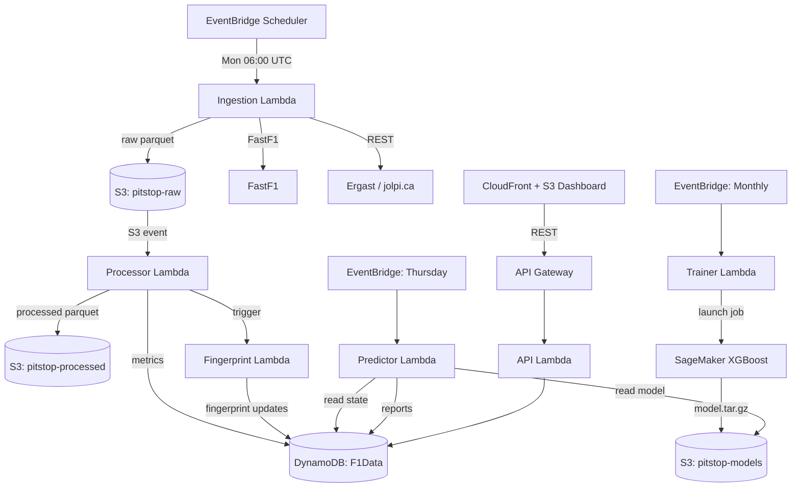

# PitStop Analytics

A serverless F1 race intelligence platform combining real telemetry, historical results, and machine learning to produce pre-race team analysis reports.

Built on AWS (Lambda, DynamoDB, S3, SageMaker, CloudFront) with a React-style vanilla JS dashboard.

---

## Architecture



---

## The 8-dimension fingerprint

Every team is scored 0–100 on:

| Dimension | What it measures |
|---|---|
| `straight_line_speed` | Top speed in DRS zones and speed traps |
| `high_speed_cornering` | Performance in >180 kph corners |
| `low_speed_cornering` | Mechanical grip in <100 kph corners |
| `tyre_management` | Lap time degradation rate over a stint |
| `qualifying_pace` | Single-lap pace vs pole |
| `race_pace_conversion` | Quali position → race position delta |
| `tyre_strategy_execution` | Pit timing and undercut effectiveness |
| `wet_weather_performance` | Performance delta in wet/mixed conditions |

Scores use an exponentially weighted rolling average — the most recent race carries roughly 2× the weight of a race eight rounds ago.

---

## How upgrade detection works

We never need to scrape upgrade news. After every race, the team's new fingerprint is computed and compared to the rolling baseline using **Welch's t-test** per dimension (unequal variance, robust to small samples). If `p < 0.1` on any dimension, an `UPGRADE#` record is written to DynamoDB with the affected dimensions, deltas, and a confidence score.

Cross-referencing upgrade deltas against the upcoming circuit profile gives a projected lap-time benefit per circuit.

---

## Circuit profiling

Every circuit gets weights (0–1) on the same 8 dimensions, describing what the track rewards. Monaco scores 0.95 on `low_speed_cornering` and 0.15 on `straight_line_speed`; Monza is the inverse.

`compute_track_compatibility(team_fingerprint, circuit_profile)` returns an overall 0–100 score plus per-dimension breakdown, surfacing strengths exploited and weaknesses exposed.

---

## ML model

**XGBoost multi-class classifier** (predicts finishing-position bracket: P1 / P2-3 / P4-5 / P6-10 / P11+).

Why XGBoost, not a neural network:

- Explainable via SHAP values — every prediction comes with feature-importance reasoning
- Handles structured tabular data with ~3,500 training rows well
- Lambda inference <100 ms
- Trains in the SageMaker built-in container (no custom image)

See `ml/features.py` for the full feature list (team fingerprint + circuit compatibility + recent form + championship context + upgrade recency + practice pace + weather).

---

## Deployment

### Prerequisites

- AWS account, AWS CLI configured for region `ap-southeast-2`
- SAM CLI ≥ 1.100
- Python 3.11
- Node 18+ (for frontend build)

### Phase 1 — data pipeline + dashboard

```bash
make install
make build
make deploy
```

`sam deploy` will guide you through the first-run prompts. After deployment, seed historical data:

```bash
make seed-historical
```

### Phase 2 — ML layer

Same `make deploy` — Phase 2 resources are gated behind the `EnablePhase2` parameter (default `true`).

### Frontend

Dashboard build + sync to S3 happens via the `deploy-frontend.yml` GitHub Actions workflow on every push to `main`. To deploy manually:

```bash
cd frontend
npm ci && npm run build
aws s3 sync dist/ s3://pitstop-dashboard-<account-id>/ --delete
aws cloudfront create-invalidation --distribution-id <id> --paths "/*"
```

---

## API

Base URL: `https://api.<your-domain>.com` (or the API Gateway invoke URL).

### Phase 1

| Method | Path | Returns |
|---|---|---|
| GET | `/races/{year}` | Season race list with summary |
| GET | `/races/{year}/{round}` | Full race detail (laps, results, sectors) |
| GET | `/drivers/{code}` | Driver profile + season history |
| GET | `/teams/{code}` | Team profile + season results |
| GET | `/standings/{year}/{round}` | Both standings tables at a round |

### Phase 2

| Method | Path | Returns |
|---|---|---|
| GET | `/predictions/{year}/{round}` | Pre-race report for every team |
| GET | `/team/{code}/fingerprint` | Current 8-d fingerprint + trend |
| GET | `/team/{code}/circuit/{key}` | Team × circuit compatibility breakdown |
| GET | `/circuit/{key}/teams` | All teams ranked at this circuit |
| GET | `/championship/{year}/scenarios` | Monte Carlo title probabilities |
| GET | `/upgrades/{year}/{team_code}` | Detected upgrade events |

Example responses in `docs/api-examples/`.

---

## Local development

```bash
make install
make test            # all unit tests
sam local start-api  # API Gateway + Lambda locally
```

FastF1 caches session data on disk (`fastf1_cache/`) — first run on a session can be slow.

---

## Limitations and known gaps

- FastF1 telemetry is rate-limited at the source; backfill scripts pace requests.
- Ergast public mirror (jolpi.ca) has occasional 5xx — clients retry with exponential backoff.
- Wet-weather samples are sparse; the `wet_weather_performance` dimension carries a `confidence` field that drops below 0.5 when fewer than 4 wet sessions are in the rolling window.
- Upgrade detector is sensitive to one-off anomalies (driver error, safety car timing). The `confidence` score below 0.6 should be treated as noise.

---

## Future improvements

- Real-time qualifying delta updates streamed via WebSocket on race weekends
- Tyre compound forecasting from FP1/FP2 long-run analysis
- Direct integration with Open-Meteo for race-window weather windows
- LLM-generated narrative summaries on top of the structured report
- Driver-specific fingerprints (separate from team) to model driver vs car contribution
